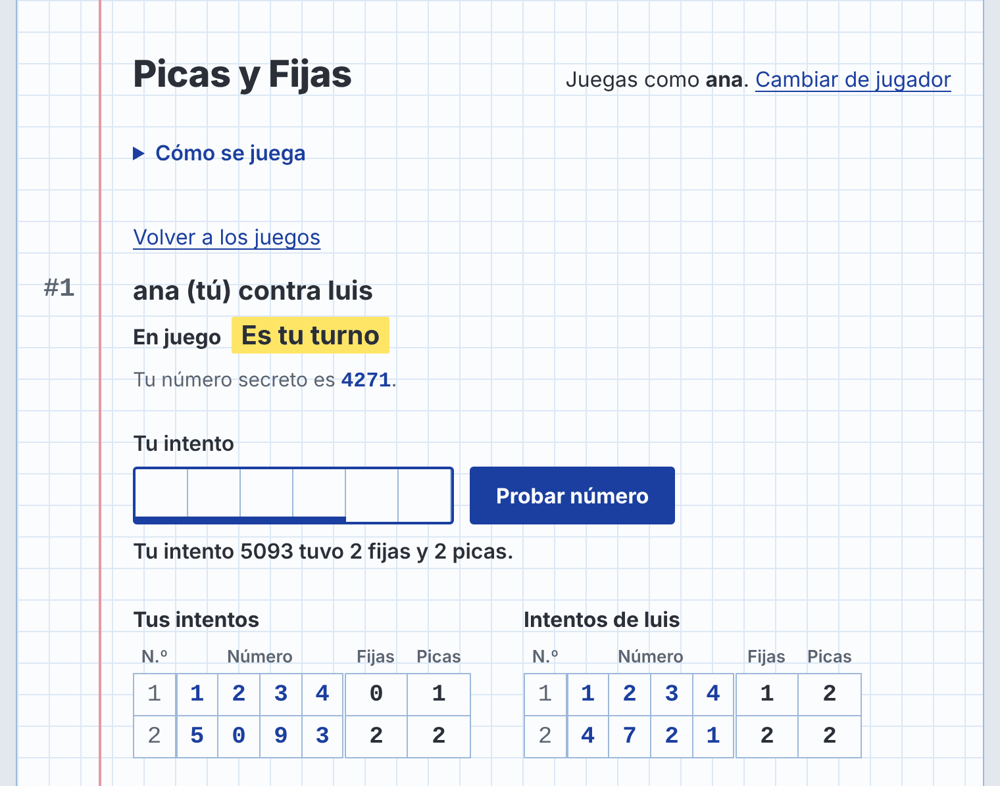
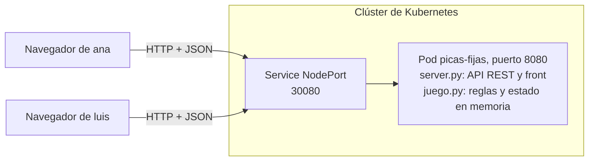

# Picas y Fijas, versión distribuida

El juego de adivinar el número secreto del rival, como servicio REST que corre en Kubernetes. Dos jugadores se conectan desde su navegador (o con `curl`), uno crea un juego, el otro se une y el servicio alterna los turnos y responde cuántas **fijas** (dígito en su posición) y **picas** (dígito en otra posición) tuvo cada intento.

- API REST con JSON, hecha en Python **sin dependencias** (solo biblioteca estándar).
- Front básico para probar, servido por el mismo pod.
- Estado en memoria, sin base de datos.
- Manifiestos de Kubernetes y `Dockerfile`.



## Probar en un minuto, sin Kubernetes

Solo necesitas Python 3.8 o superior:

```bash
python3 app/server.py
```

Abre <http://localhost:8080> en **dos pestañas**, entra con un nombre distinto en cada una, crea un juego en la primera y únete desde la segunda.

Si el puerto 8080 está ocupado, usa otro: `PUERTO=9000 python3 app/server.py`.

## Desplegar en Kubernetes (por ejemplo en Killercoda)

En el playground de Kubernetes de [Killercoda](https://killercoda.com/playgrounds), clona el repositorio y elige una de las dos formas.

```bash
git clone https://github.com/TU_USUARIO/picas-fijas.git
cd picas-fijas
```

### Forma rápida: sin construir imagen

Usa la imagen oficial `python:3.13-alpine` y monta el código desde un ConfigMap. Sirve porque la app no instala nada.

```bash
kubectl create configmap picas-fijas-codigo --from-file=app/
kubectl apply -f k8s/rapido/ -f k8s/service.yaml
kubectl rollout status deployment/picas-fijas
```

### Forma con imagen propia

Construye la imagen con el `Dockerfile` y publícala (aquí en Docker Hub). Hazlo en cualquier máquina con Docker.

```bash
docker build -t TU_USUARIO/picas-fijas:1.0 .
docker push TU_USUARIO/picas-fijas:1.0
```

Cambia `TU_USUARIO` en la línea `image:` de `k8s/deployment.yaml` y despliega:

```bash
kubectl apply -f k8s/
kubectl rollout status deployment/picas-fijas
```

### Abrir el juego

El Service es de tipo NodePort y publica el puerto **30080** en los nodos.

- En Killercoda: menú de la esquina superior derecha, **Traffic / Ports**, puerto `30080`. Abre esa dirección en dos pestañas, o compártela con otra persona.
- En otro clúster: `http://IP_DE_UN_NODO:30080`.
- Si el NodePort no es alcanzable: `kubectl port-forward --address 0.0.0.0 service/picas-fijas 8080:80` y abre el puerto 8080.

### Comandos útiles

```bash
kubectl get pods,svc -l app=picas-fijas   # qué está corriendo
kubectl logs -f deployment/picas-fijas    # peticiones que recibe el pod
kubectl delete pod -l app=picas-fijas     # Kubernetes lo recrea, pero las partidas se pierden

# Forma rápida: volver a cargar el código después de cambiarlo
kubectl create configmap picas-fijas-codigo --from-file=app/ --dry-run=client -o yaml | kubectl apply -f -
kubectl rollout restart deployment/picas-fijas

# Borrar todo
kubectl delete deployment,service picas-fijas
kubectl delete configmap picas-fijas-codigo --ignore-not-found
```

## API

Todas las peticiones y respuestas son JSON. El jugador se identifica con su `nombre`, que debe haber pasado antes por `/login`.

| Método y ruta | Qué hace | Cuerpo | Respuesta |
| --- | --- | --- | --- |
| `POST /login` | Registra el nombre del jugador | `{"nombre"}` | `201` si es nuevo, `200` si ya existía |
| `POST /juego` | Crea un juego, que queda `por_iniciar` | `{"nombre", "numero"}` | `201`, el juego y la cabecera `Location` |
| `PUT /juego/{id}` | Se une al juego: pasa a `en_juego` y se sortea quién empieza | `{"nombre", "numero"}` | `200` y el juego |
| `POST /juego/{id}/jugar` | Envía un intento; solo si es su turno | `{"nombre", "numero"}` | `200` con fijas, picas y el turno siguiente |
| `GET /juego/{id}` | Estado de un juego | | `200` y el juego |
| `GET /juego` | Lista todos los juegos; acepta `?estado=por_iniciar`, `en_juego` o `terminado` | | `200` y la lista |

Un juego pasa por tres estados: `por_iniciar` (falta el segundo jugador), `en_juego` y `terminado` (con su `ganador`). Se ve así; `numeros`, con los secretos, solo aparece cuando está `terminado`.

```json
{
  "id": 1,
  "estado": "en_juego",
  "creador": "ana",
  "jugadores": ["ana", "luis"],
  "turno": "ana",
  "ganador": null,
  "intentos": [
    {"jugador": "luis", "numero": "1234", "fijas": 1, "picas": 2}
  ]
}
```

Respuesta de `POST /juego/{id}/jugar`:

```json
{
  "jugador": "luis", "numero": "1234",
  "fijas": 1, "picas": 2, "gano": false,
  "mensaje": "1 fija y 2 picas",
  "estado": "en_juego", "turno": "ana"
}
```

Los errores tienen la forma `{"error": "mensaje"}` y estos códigos:

| Código | Cuándo |
| --- | --- |
| `400` | JSON inválido, falta un campo, o el nombre o el número no cumplen las reglas |
| `401` | El jugador no ha hecho `/login` |
| `403` | El jugador no participa en ese juego |
| `404` | El juego o la ruta no existen |
| `405` | Método no permitido en esa ruta |
| `409` | No es su turno, el juego no ha iniciado, ya terminó o ya tiene dos jugadores |
| `413` | Cuerpo de más de 10 kB |

### Validación del número

El servicio rechaza con `400` y un mensaje específico cualquier número que no sea de exactamente 4 dígitos distintos: con letras, espacios o símbolos (`12a4`), con más o menos dígitos (`123`, `12345`), con dígitos repetidos (`1123`) o vacío. Envíalo como texto (`"0123"`) para conservar los ceros a la izquierda.

El front no valida a propósito: deja escribir cualquier cosa y también jugar fuera de turno, para que se vea la respuesta del servicio.

### Una partida completa con curl

```bash
URL=http://localhost:8080
# En Kubernetes, desde la terminal del clúster:
# URL=http://$(kubectl get nodes -o jsonpath='{.items[0].status.addresses[?(@.type=="InternalIP")].address}'):30080
J='Content-Type: application/json'

curl -s -X POST $URL/login -H "$J" -d '{"nombre": "ana"}'
curl -s -X POST $URL/login -H "$J" -d '{"nombre": "luis"}'
curl -s -X POST $URL/juego -H "$J" -d '{"nombre": "ana", "numero": "4271"}'
curl -s -X PUT  $URL/juego/1 -H "$J" -d '{"nombre": "luis", "numero": "0593"}'
curl -s $URL/juego/1    # "turno" dice quién empieza
curl -s -X POST $URL/juego/1/jugar -H "$J" -d '{"nombre": "luis", "numero": "1234"}'
curl -s -X POST $URL/juego/1/jugar -H "$J" -d '{"nombre": "ana", "numero": "0593"}'
curl -s $URL/juego      # todos los juegos, con su estado y quién los creó
```

Si le toca a `ana` primero, el intento de `luis` responde `409` con `No es tu turno: le toca a ana.`

## Cómo está hecho



```text
app/
  juego.py      reglas (validar, contar picas y fijas) y estado de las partidas
  server.py     capa HTTP: tabla de rutas, JSON, front y /healthz
  index.html    front básico; consulta el estado cada 2 segundos
k8s/
  deployment.yaml         Deployment con imagen propia
  service.yaml            Service NodePort 30080
  rapido/deployment.yaml  Deployment sin imagen propia (código en un ConfigMap)
tests/          pruebas de las reglas, de una partida y del API por HTTP
docs/           captura del front para este README
Dockerfile
```

## Decisiones de diseño y límites

- **Estado en memoria, una sola réplica.** El enunciado no exige base de datos, así que jugadores y partidas viven en la memoria del proceso. Por eso el Deployment tiene `replicas: 1` y estrategia `Recreate`: con dos pods, cada uno tendría sus propios juegos. Si el pod se reinicia, las partidas se pierden. Para escalar a varias réplicas habría que mover el estado a un almacén compartido, por ejemplo Redis.
- **Concurrencia.** El servidor atiende cada petición en un hilo y un candado protege el estado, de modo que dos jugadores no pueden unirse al mismo juego ni jugar el mismo turno a la vez.
- **Identidad por nombre.** `/login` registra el nombre y las demás peticiones lo envían en el cuerpo, como pide el enunciado. No hay contraseñas ni tokens: quien conozca un nombre puede jugar por él. Repetir `/login` con el mismo nombre no falla, para poder recargar la página.
- **Números como texto.** Se permiten ceros a la izquierda (`0123`), por eso el número viaja como texto y no como entero.
- **Números secretos.** El servicio nunca los devuelve mientras el juego está en curso; los revela cuando termina.
- **Fin del juego.** Gana el primero que adivina y el juego termina en ese momento, sin turno de desquite.
- **Sin dependencias.** `http.server` basta para este tamaño y permite desplegar sin construir imagen. Para producción convendría un servidor WSGI o ASGI.
- **Sondas y apagado.** `/healthz` alimenta las sondas `readiness` y `liveness`, y el proceso atiende `SIGTERM` para que el pod se detenga de inmediato.

## Pruebas

```bash
python3 -m unittest discover -s tests -v
```
